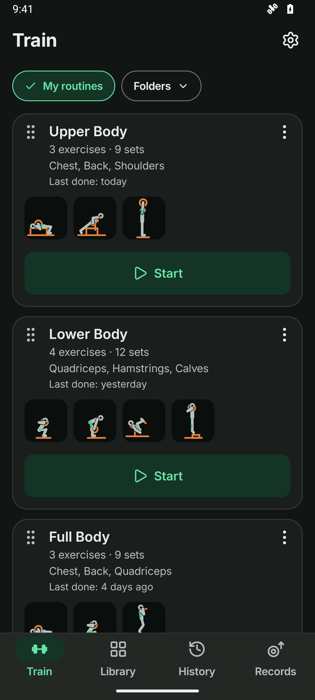
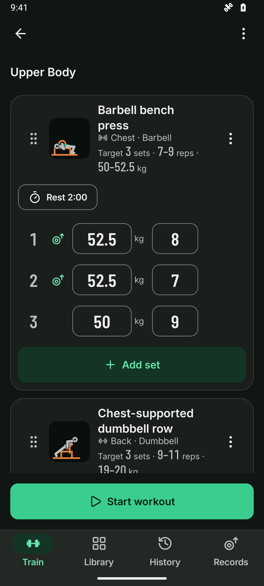
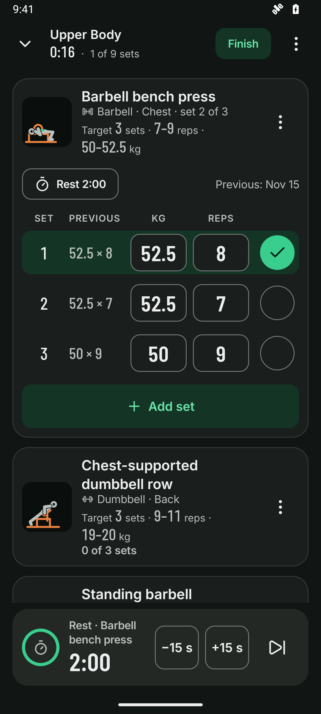
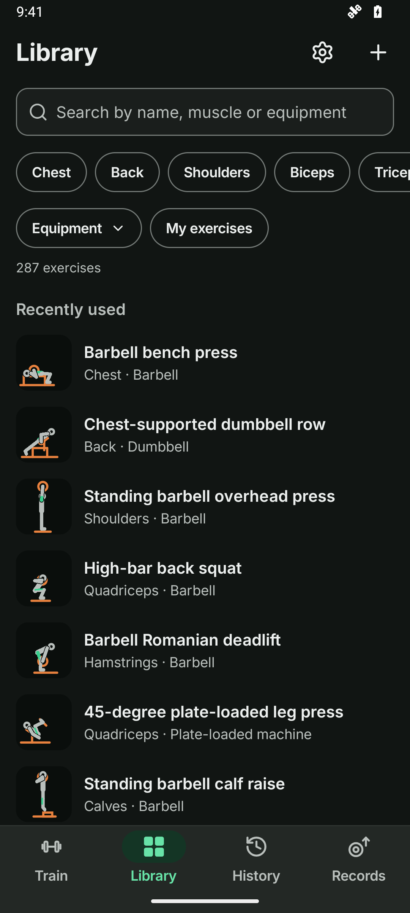
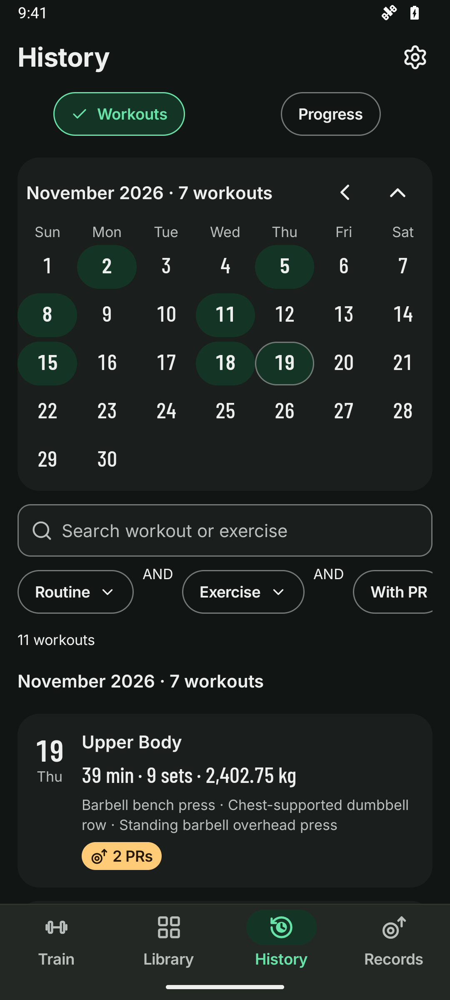
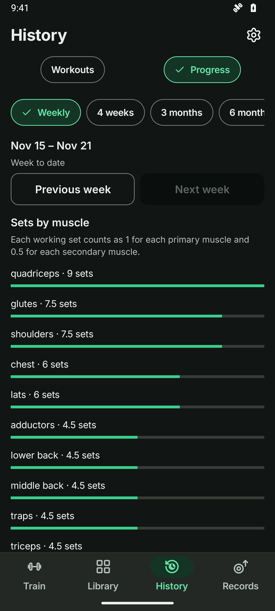
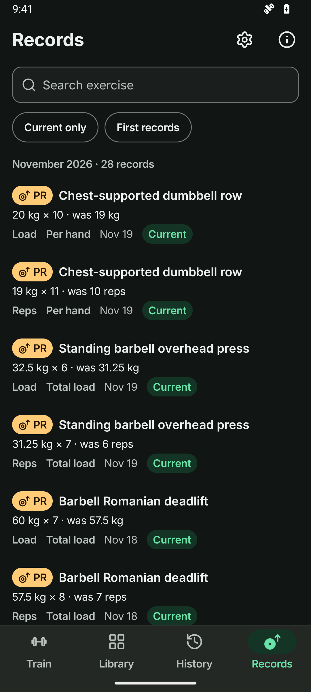
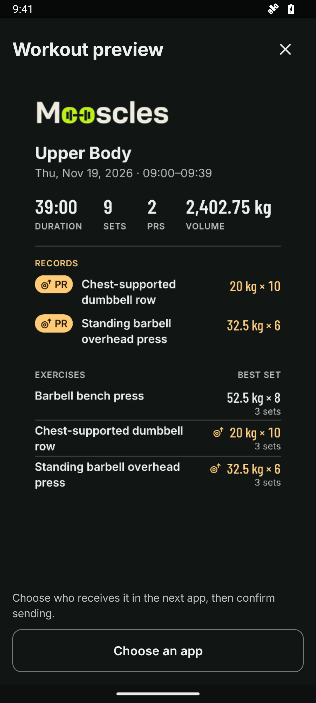

# Mooscles

A private, offline workout journal for Android. Plan routines, log sets in a few taps, and follow your records and progress. All data stays on your phone.

**[Download the latest release](https://github.com/ReiTut/Mooscles/releases/latest)** · Android 8.0+ · English and Português (Brasil)

## Screenshots

Captured on an Android 15 emulator using sample workout data. Select an image to view it at full size.

| Train | Routine editor | Active workout | Exercise library |
| --- | --- | --- | --- |
| [](docs/screenshots/train.png) | [](docs/screenshots/routine-editor.png) | [](docs/screenshots/active-workout.png) | [](docs/screenshots/library.png) |

| Workout history | Weekly progress | Personal records | Share preview |
| --- | --- | --- | --- |
| [](docs/screenshots/history.png) | [](docs/screenshots/weekly-progress.png) | [](docs/screenshots/records.png) | [](docs/screenshots/share-preview.png) |

## Features

- **Routines:** organize routines in folders, reorder exercises by dragging, and plan each set's weight and reps, warm-ups, rest time, or **Follow the record**.
- **Workouts:** every set starts from your previous session, so logging is usually one tap. Adjust with a stepper or the keyboard, swipe to complete or remove (with Undo), and rest with a timer that also runs in the notification.
- **Exercise library:** 287 exercises with bilingual search, muscle and equipment filters, a body map, execution cues, and your own custom exercises with photos.
- **Records:** load and reps records per exercise. Reps records count at your heaviest load, and an exercise's first session counts as one record.
- **History and progress:** a calendar with filters, editable saved workouts, charts for load, estimated 1RM, volume and reps, and weekly sets by muscle.
- **Sharing:** builds a workout card image on the phone and opens the app you choose; nothing is sent automatically.
- **Your data:** export everything to a JSON file and import it back through the Android file picker.

## Privacy

No account, backend, ads or analytics. The only network use is checking and downloading public releases from this repository. Android cloud backup is disabled, so uninstalling removes your data. Use **Settings → Your data** to keep an export.

## Install and update

Download `Mooscles-vX.Y.Z-debug.apk` from the [latest release](https://github.com/ReiTut/Mooscles/releases/latest) and open it on your phone. Installed copies check for new releases in **Settings → App updates**. Before installing, the app checks the package name, version, signing certificate and SHA-256, and waits until no workout or rest timer is active. Android may ask you to approve each update. See [UPDATES.md](UPDATES.md).

## Build from source

Requirements: JDK 21, Android SDK platform `android-37.0` and build-tools 36.0.0, with `sdk.dir` set in an untracked `local.properties`.

```powershell
.\gradlew.bat :app:assembleDebug   # app/build/outputs/apk/debug/app-debug.apk
.\build.ps1                        # host tests, lint, builds and release preparation
```

On macOS and Linux, run the scripts with PowerShell 7 (`pwsh ./build.ps1`). Release preparation only accepts APKs signed with the original key, so on other machines `build.ps1` stops at that step by design after tests and builds pass. CI runs in [GitHub Actions](.github/workflows/ci.yml).

| Module | Contents |
| --- | --- |
| `:shared` | Room database and migrations, repository, exercise catalog, record and progress calculations, backup, preferences, rest timer logic and the shared view model |
| `:designsystem` | Compose Multiplatform tokens, components, charts, icons, fonts and strings |
| `:screens` | The app's screens, built on the design system |
| `:app` | Android activity, navigation, notifications, updater, sharing and photos |

## Documentation

- [Release notes](docs/superpowers/releases/v1.5.11.md) for the current release, 1.5.11 / Build 34
- [VERIFICATION.md](VERIFICATION.md): what each release was tested on, and what was not
- [UPDATES.md](UPDATES.md): the update channel and the release procedure
- [PERFORMANCE.md](PERFORMANCE.md) and [SHARING.md](SHARING.md)
- [AGENTS.md](AGENTS.md): architecture, conventions and compatibility rules for contributors
